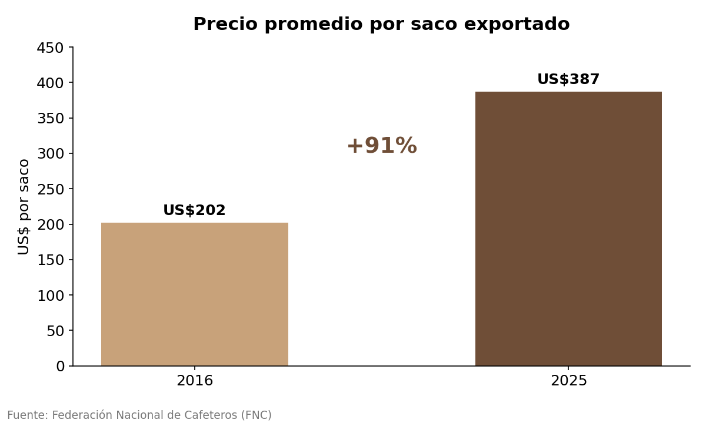
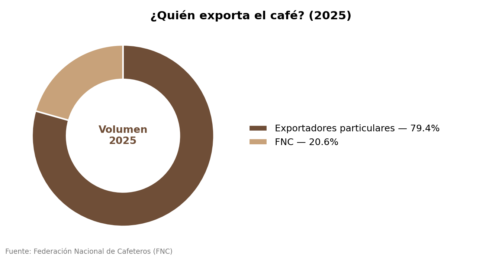
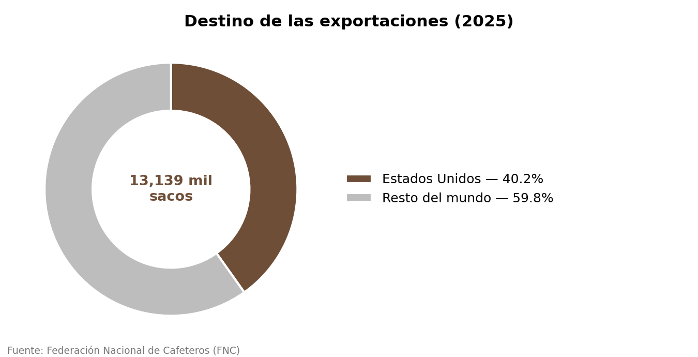
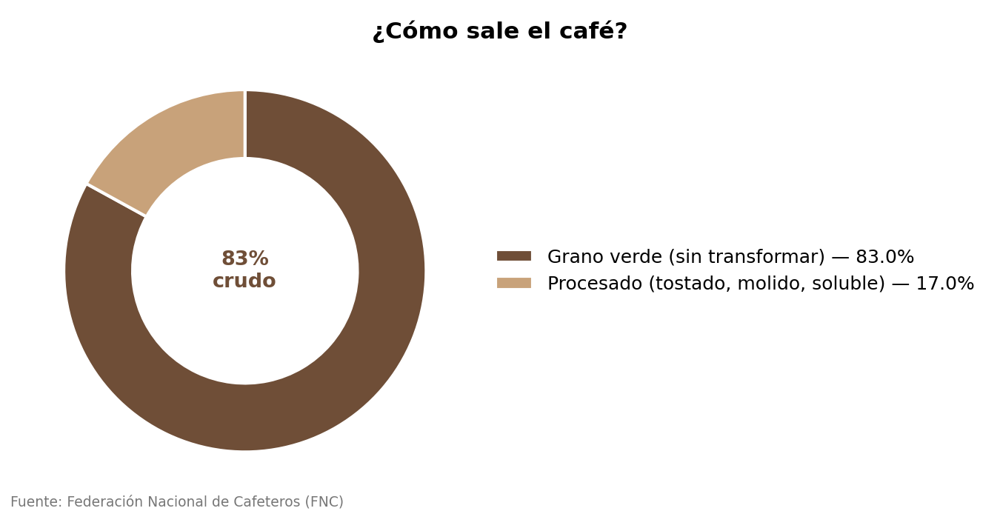
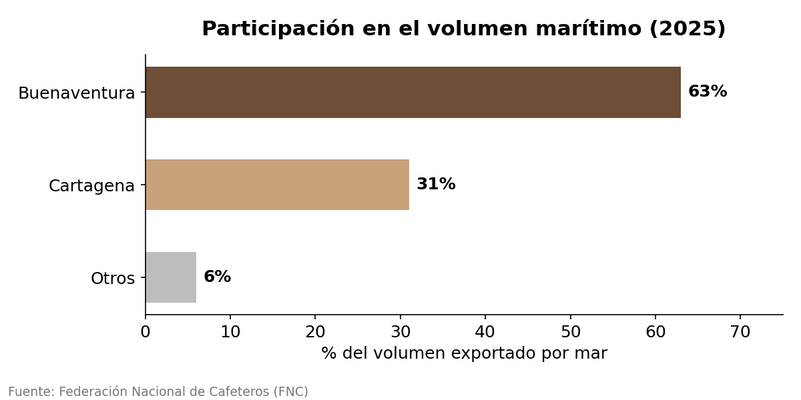

# ☕ Exportaciones de café colombiano — análisis con SQL

Análisis del comportamiento de las exportaciones de café de Colombia entre 2016 y 2026, usando datos oficiales de la Federación Nacional de Cafeteros (FNC).

Lo hice porque quería practicar SQL con algo que realmente me interesa. Soy de Anserma, Caldas, zona cafetera, y tengo formación en Finanzas, así que tenía sentido juntar las dos cosas en vez de usar un dataset genérico de curso.

---

## Pregunta de negocio

¿Cómo se ha movido el negocio del café colombiano en la última década: quién lo exporta, para dónde se va y qué tanto de ese café sale como materia prima sin transformar?

## Fuente de datos

Federación Nacional de Cafeteros, Estadísticas Cafeteras (archivo oficial, actualizado a julio de 2026). El archivo original y las tablas ya limpias en SQLite están en [`/data`](data/).

## Herramientas

- **SQL (SQLite)** para limpieza, agregaciones y cálculo de participaciones
- Consultas en [`/queries/consultas.sql`](queries/consultas.sql)

---

## Hallazgos

### 1. El precio por saco casi se duplicó en 10 años

Pasó de **US$202 en 2016 a US$387 en 2025**, un aumento de 91%, y casi todo se concentró entre 2021 y 2025. Coincide con lo que salía en las noticias de esos años sobre precios récord del café.



### 2. Los exportadores particulares mueven cerca del 80% del volumen

No es la Federación la que más exporta. En 2025 la FNC exportó directamente el **20.6%**; el resto lo manejaron comercializadoras privadas.



### 3. Estados Unidos sigue siendo, de lejos, el principal comprador

Se llevó el **40% de todo lo exportado en 2025** (5,277 mil sacos de 13,139 mil). El segundo destino, Canadá, ni siquiera llega al 8%.



### 4. El 83% del café sale como grano verde, sin transformar

Solo el 17% tiene algún nivel de procesamiento (tostado, molido o soluble). Colombia sigue exportando sobre todo materia prima y no producto con valor agregado. Esto ya lo sabía de oídas, pero verlo en el dato es distinto.



### 5. Buenaventura es el puerto que más mueve

Concentró el **63% del volumen marítimo en 2025**, casi el doble que Cartagena (31%).



---

## Lo que pienso de esto

El dato que más me llamó la atención fue el del grano sin transformar. Si el 83% del café sale crudo, ahí hay una oportunidad de negocio que Colombia no está aprovechando del todo, porque el café tostado o soluble se vende más caro por saco. No es un hallazgo nuevo (es una discusión que existe hace años en el sector), pero confirmarlo con los datos reales de los últimos años le da peso.

## Qué haría diferente / limitaciones

- Los datos de puertos y de destino solo cubren desde 2000 y 2015 respectivamente, así que no pude compararlos contra el histórico completo de precio, que sí llega hasta 1958.
- Me faltó cruzar esto con la tasa de cambio para separar cuánto del aumento en precio viene del café mismo y cuánto de la devaluación del peso. Es lo siguiente que quiero agregar.

---

## Cómo reproducir el análisis

1. Clonar el repositorio.
2. Abrir `data/cafe_exportaciones.db` con SQLite (o con [DB Browser for SQLite](https://sqlitebrowser.org/)).
3. Ejecutar las consultas de `queries/consultas.sql`.

```bash
sqlite3 data/cafe_exportaciones.db < queries/consultas.sql
```

## Estructura del proyecto

```
exportaciones-cafe-colombiano/
├── README.md
├── data/
│   └── cafe_exportaciones.db
├── images/
│   ├── 01_precio_por_saco.png
│   ├── 02_quien_exporta.png
│   ├── 03_destinos.png
│   ├── 04_verde_vs_procesado.png
│   └── 05_puertos.png
└── queries/
    └── consultas.sql
```

---

## Contacto

**Anderson Mateo Iglesias Suarez**, analista de datos
📧 smateoiglesias@gmail.com
